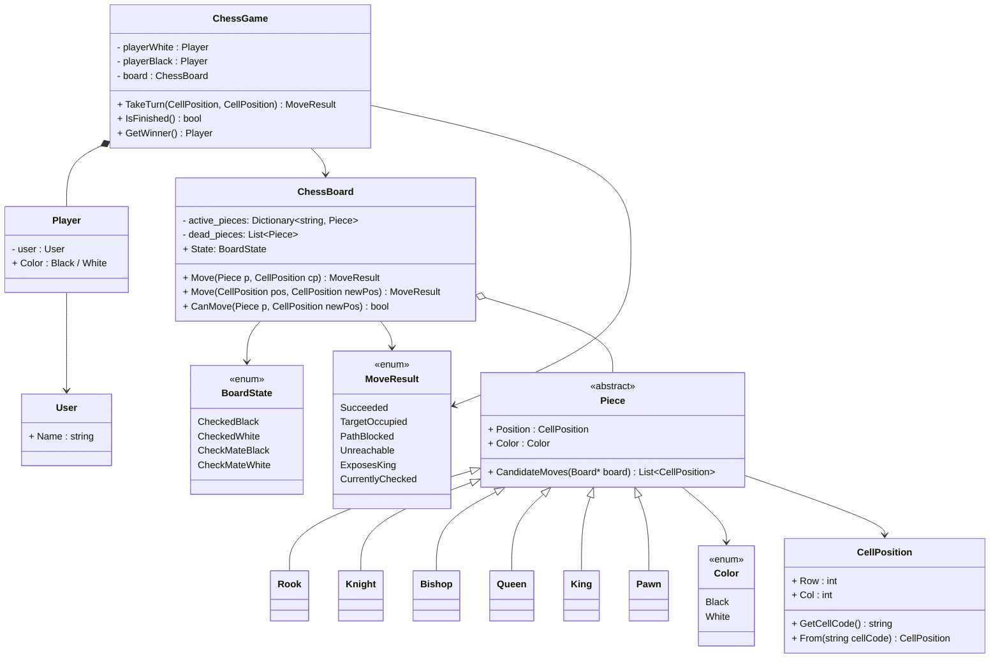

### Chess Game - Design

#### Rules of game
- White starts the game
- There are special rules - pawn to any character, castling, etc. ( we will skip those for now)
- If moving a piece exposes an attack on king, we can not move the piece.

#### Entities 
- Pieces : A game consists of black and white pieces of different types. Each piece has different movement constraints.
- Board : An 8x8 grid where the pieces are arranged and moved.
- Player : 2 players, each owning black and white pieces
- Game : Consist of 2 players, who take turns 1 by 1, until the other king is check mate.

#### State
There are two types of states that I can think of right now:
1. Game State - It can be in progress, check of black / white king, checkmate on black / white king
2. Piece State - It can be either dead or alive

