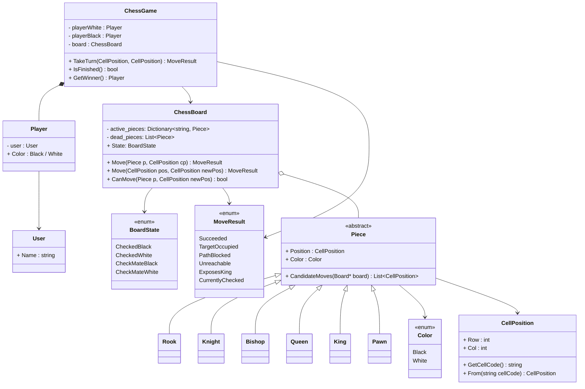

# Chess Game - Design v2

## Rules of the game
1. Board is a 8x8 grid.
2. It contains 2 players - black and white
3. Each player has 16 pieces: 
    - 8 pawns, a king and a queen
    - 2 rooks, knights and bishops
4. Each piece has it's own movement strategy
5. There are special moves - castling, pawn double, pawn promotion.
6. In chess, game can be in the following states - progress, checked, checkmate or stalemate / draw.

## Functional Requirements
1. All the rules of chess are implemented.
2. History of moves and replay. (v2)
3. Players can undo a move.
4. Validate moves.
5. Detect board state.
6. Support special moves. (v2)
7. Observers who can watch the match. (v3)
8. Timer functionality (v3)

#### Entities and Roles
- **abs. Piece** - A game consists of black and white pieces of different types. Each piece moves differently. Concrete classes - King, Queen, Bishop, Knight, Rook, Pawn.
- **Board** : An 8x8 grid where the pieces are arranged and moved.
- **Player** : Identity and Color.
- **Game** : 2 players, turn taking.
- **Move** : From and To positions storage.

#### Task Items
- [x] enums.csx
- [x] models.csx
- [x] cell.csx
- [] pieces.csx
- [x] move.csx
- [] board.csx
- [x] rules.csx
- [x] game.csx
- [x] main.csx
- [x] prints.csx

#### Class Diagram

